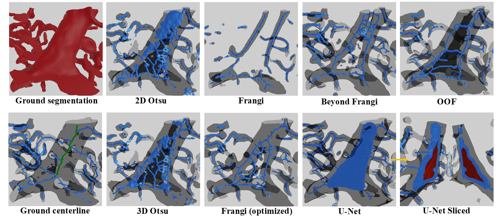

# MicroVasc-Review

**Review of Segmentation and Skeletonization Methods for Large-Scale Microvascular Networks**

This repository contains code and resources associated with the paper
"*Segmentation and Modeling of Large-Scale Microvascular Networks: A Survey*" by Goharbavang *et al*.

📄 **[Read the Full Paper](https://www.frontiersin.org/journals/bioinformatics/articles/10.3389/fbinf.2025.1645520/full)**

<p align="center">
  
</p>

## Pipeline

The code covers the three stages compared in the paper:

1. **Binarize** a 3D volume: `binarize otsu2d`, `otsu3d`, `frangi`, `bfrangi`.
2. **Skeletonize** the binary volume: `skeleton lee`, `palagyi`, `kline`, and `kerautret`
   (a wrapper around the external CDCVAM program).
3. **Evaluate** the results against a ground truth: Jaccard, Dice, precision and recall for
   binary volumes, NetMets precision and recall for skeletons.

The other methods in the paper (Optimally Oriented Flux, U-Net, nnU-Net, Tagliasacchi, Antiga)
are not implemented here. The documentation pages link to their implementations.

## Installation

Python 3.9 or newer. The test workflow runs on Python 3.12 and 3.14.

```bash
git clone https://github.com/helia77/MicroVasc-Review.git
cd MicroVasc-Review
pip install -e .
```

The core install needs only NumPy, SciPy and scikit-image. Optional parts are installed as extras:

| Extra | Installs | Needed for |
|---|---|---|
| `kline` | scikit-fmm | `skeleton kline` |
| `io` | opencv-python, pynrrd, SimpleITK | image stacks, NRRD files and resampling in `microvasc.data` |
| `test` | pytest | running the tests |
| `all` | all of the above | |

```bash
pip install -e ".[kline]"
pip install -e ".[all]"
```

On some platforms pip builds scikit-fmm from source, which needs a compiler and the Python
development headers.

## Quick start

Binarize, skeletonize and evaluate a synthetic tube:

```python
import numpy as np

from microvasc.binarize import Binarizer
from microvasc.skeleton import Skeletonize
from microvasc.metrics.geometry import metric
from microvasc.metrics.network import netmets, voxel_skeleton_to_segments

# a bright tube along axis 0 on a dark, noisy background
_, y, x = np.mgrid[:32, :32, :32]
truth = (y - 16) ** 2 + (x - 16) ** 2 <= 4 ** 2
rng = np.random.default_rng(0)
volume = truth + 0.2 * rng.standard_normal(truth.shape)

mask = Binarizer(volume, background="black").otsu3d()
print("Jaccard", metric(truth, mask).jaccard())

skeleton = Skeletonize().lee(mask)
centerline = [[[0, 16, 16], [31, 16, 16]]]      # the true centerline as one segment
precision, recall = netmets(voxel_skeleton_to_segments(skeleton), centerline, sigma=1.0)
print("NetMets precision", precision, "recall", recall)
```

The same steps from the command line, on `.npy` files:

```bash
binarize otsu3d --input volume.npy --output mask.npy
skeleton lee --input mask.npy --output skeleton.npy
```

## Documentation

| Page | Contents |
|---|---|
| [Binarization](docs/binarize.md) | Otsu, Frangi and Beyond Frangi, `binarize` options, external methods |
| [Skeletonization](docs/skeleton.md) | Lee, Palágyi, Kline and Kerautret, `skeleton` options, settings used in the paper |
| [Metrics](docs/metrics.md) | Jaccard, Dice, precision, recall, and NetMets with per-input scales |
| [Parameter optimization](docs/optimization.md) | Slurm sweeps for alpha, c, beta and tau, and J = F / (2 - F) |
| [Data conversion](docs/data.md) | NWT, OBJ, OFF, NRRD and image stack helpers in `microvasc.data` |

Development setup and tests: [CONTRIBUTING.md](CONTRIBUTING.md).

## Data availability

Data availability: TODO

The imaging data and annotations used in the paper are not included in this repository.

## Citation

If you use this code or the paper, please cite the paper:

```bibtex
@article{goharbavang2025segmentation,
  title={Segmentation and modeling of large-scale microvascular networks: a survey},
  author={Goharbavang, Helya and Ashitkov, Artem T and Pillai, Athira and Wythe, Joshua D and Chen, Guoning and Mayerich, David},
  journal={Frontiers in Bioinformatics},
  volume={5},
  pages={1645520},
  year={2025},
  publisher={Frontiers Media SA},
  doi={10.3389/fbinf.2025.1645520}
}
```

The same information is in [CITATION.cff](CITATION.cff), which GitHub shows as "Cite this repository".

## License

MIT License, see [LICENSE](LICENSE). `Skeletonize.kline` is derived from poreture (BSD 3-clause),
see [THIRD_PARTY_NOTICES.md](THIRD_PARTY_NOTICES.md).
