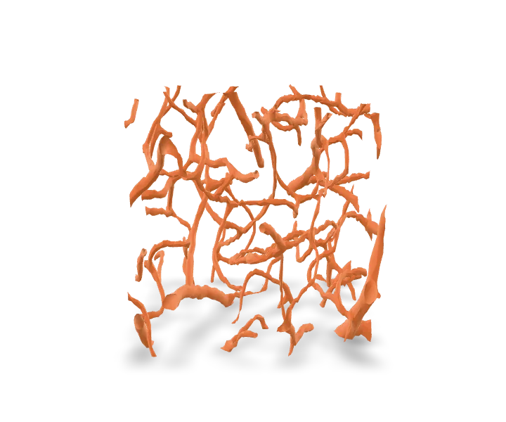
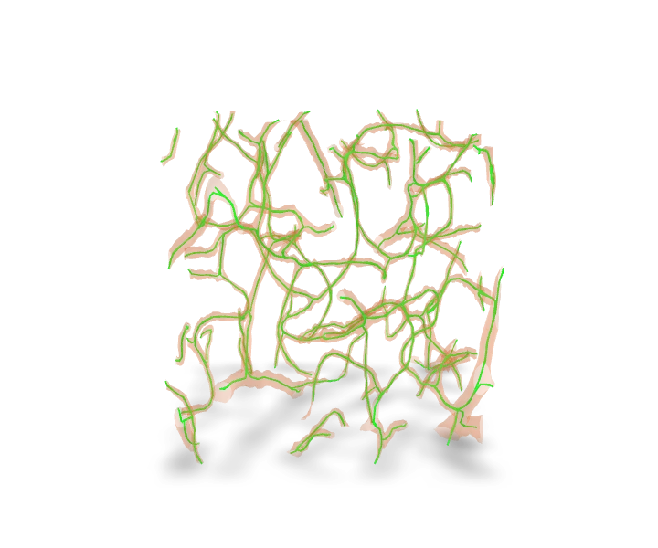

# microvasc

Python code to binarize 3D images of microvascular networks, skeletonize the binary volumes, and
evaluate both against a ground truth. It is the code for the survey paper cited below.

```bash
pip install microvasc
```

## 3D models

A segmented microvascular network and its centerline. Click an image to load the 3D model, then
drag to rotate it.

<div style="display: flex; flex-wrap: wrap; gap: 1rem">
<model-viewer src="https://www.helia-gohar.com/data/mesh/ground_segmentation.glb" alt="3D model of a segmented microvascular network" reveal="manual" camera-controls shadow-intensity="1" scale="-1 1 -1" style="display: block; flex: 1 1 280px; height: 300px">
<button slot="poster" type="button" aria-label="Load the 3D model of the segmented network" style="display: block; width: 100%; height: 100%; padding: 0; border: 0; background: none; cursor: pointer">

</button>
</model-viewer>
<model-viewer src="https://www.helia-gohar.com/data/mesh/ground_centerline.glb" alt="3D model of a microvascular network centerline" reveal="manual" camera-controls shadow-intensity="1" scale="-1 1 -1" style="display: block; flex: 1 1 280px; height: 300px">
<button slot="poster" type="button" aria-label="Load the 3D model of the centerline" style="display: block; width: 100%; height: 100%; padding: 0; border: 0; background: none; cursor: pointer">

</button>
</model-viewer>
</div>

| Page | Contents |
|---|---|
| [Binarization](binarize.md) | Otsu, Frangi, Beyond Frangi and OOF, `binarize` options, external methods |
| [Skeletonization](skeleton.md) | Lee, Palágyi, Kline and Kerautret, `skeleton` options, settings used in the paper |
| [Metrics](metrics.md) | Jaccard, Dice, precision, recall, and NetMets with per-input scales |
| [Parameter optimization](optimization.md) | Slurm sweeps for alpha, c, beta and tau, and J = F / (2 - F) |
| [Data conversion](data.md) | NWT, OBJ, OFF, NRRD and image stack helpers in `microvasc.data` |
| [Citation](citation.md) | Software and paper DOIs, BibTeX, and works that use microvasc |

## Citation

Paper: Goharbavang et al., "Segmentation and modeling of large-scale microvascular networks: a
survey", Frontiers in Bioinformatics, 2025
([doi:10.3389/fbinf.2025.1645520](https://doi.org/10.3389/fbinf.2025.1645520)).

Paper project page: [helia-gohar.com/project/microvascular-modeling-review](https://www.helia-gohar.com/project/microvascular-modeling-review/).

Software, all versions: [doi:10.5281/zenodo.23933580](https://doi.org/10.5281/zenodo.23933580).
